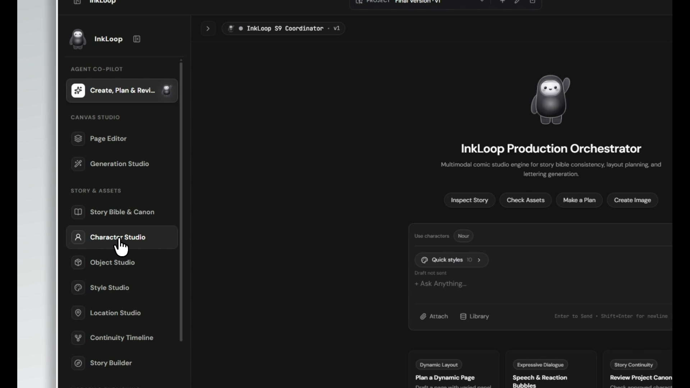
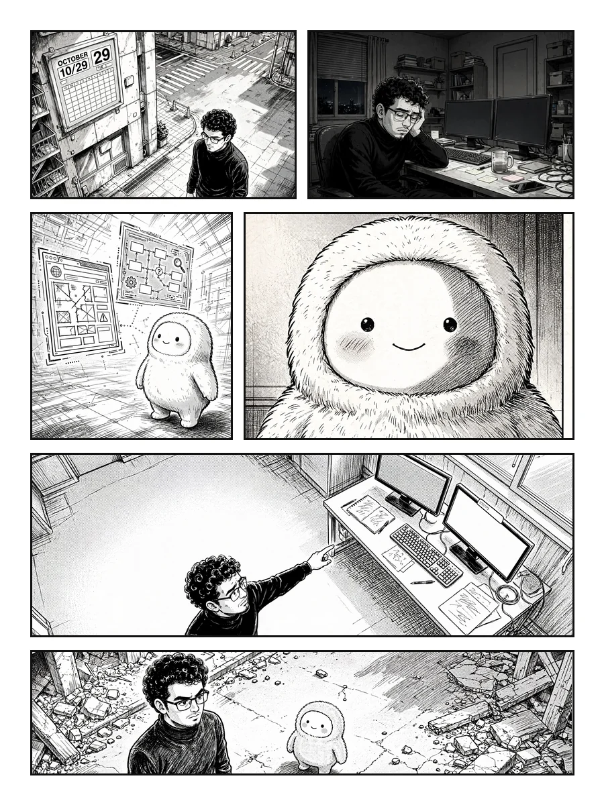
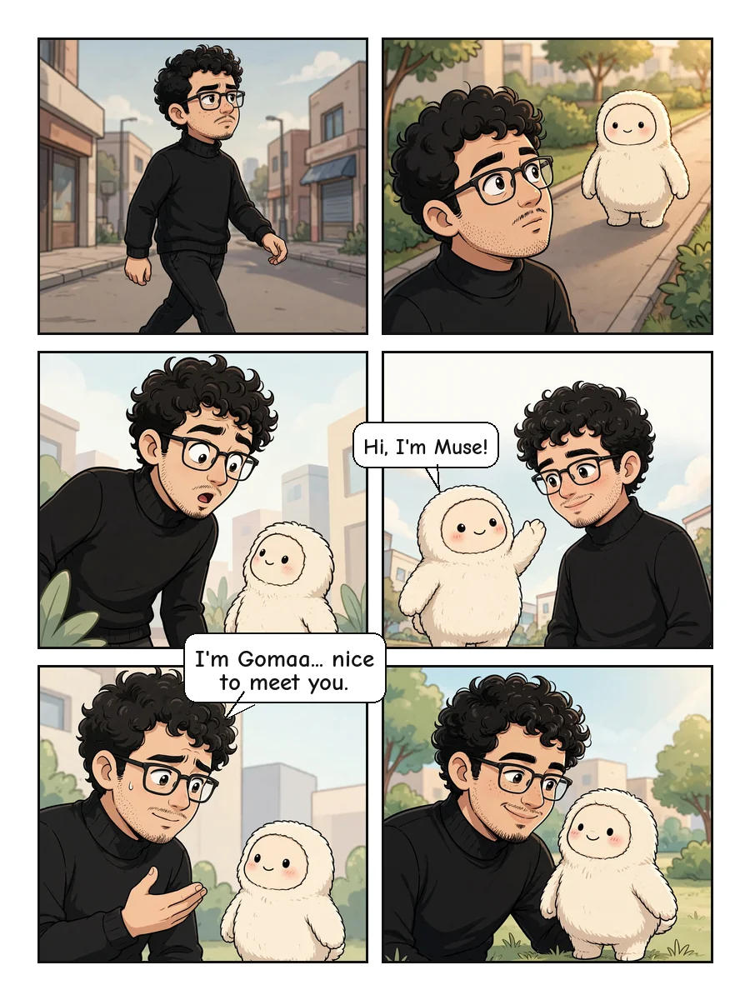
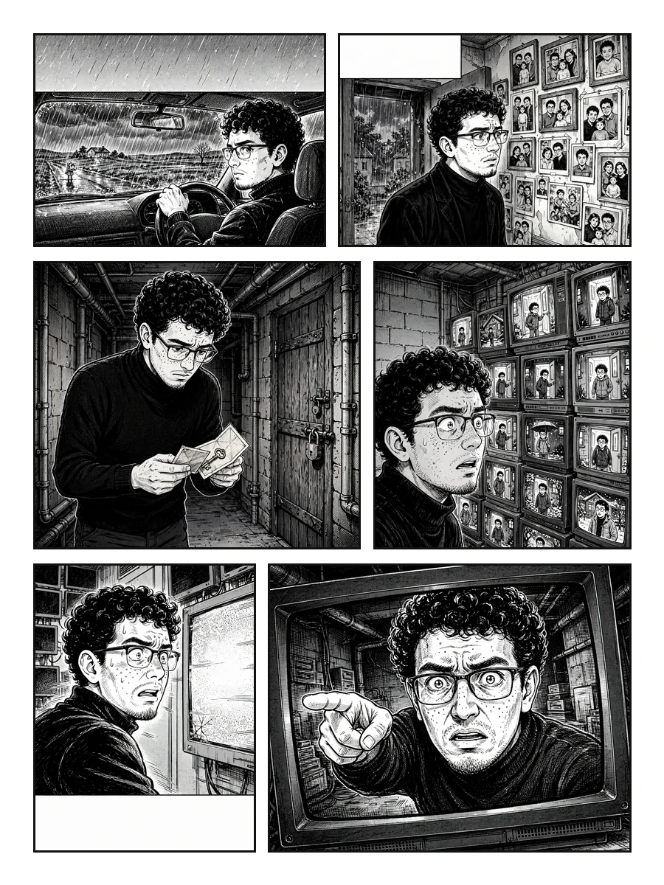
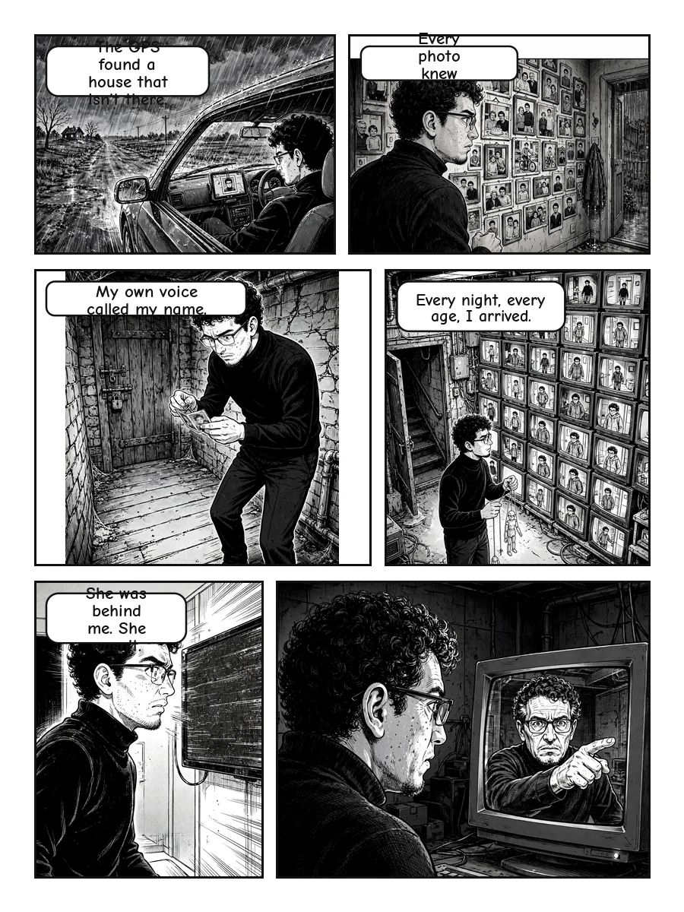

# InkLoop

> **Research-driven comic, manga, and visual storytelling production engine powered by Meta AI models with guaranteed character continuity and deterministic canvas lettering.**

---

## 1. Demo Video

[](docs/media/demo-poster.jpg)

*Full demonstration walkthrough illustrating script breakdown, panel planning, character anchor locking, and speech bubble placement.*
*(Note: The full recording `Inkloop_show.mp4` is 73.96 MB and exceeds git commit limits; preview frame shown above).*

---

## 2. Gallery

A selection of sequential comic pages generated and lettered with InkLoop:

| Action Confrontation | Narrative Dialogue | Two-Character Scene |
| :---: | :---: | :---: |
|  |  |  |

| Dramatic Reveal | Multi-Beat Pacing | Character Acting |
| :---: | :---: | :---: |
|  |  |  |

*View the full 16-page collection in the [Complete Gallery](docs/GALLERY.md).*

---

## 3. Why

AI image models forget your character. When prompting ordinary image generators from panel to panel, hair textures shift, facial proportions mutate, and outfits transform randomly.

InkLoop locks character identity and visual style through canonical anchor turnaround sheets, strict negative quality guards, and continuous verification. A full sequential comic page is the hardest test of AI visual consistency—and the proof that it works.

---

## 4. What It Does

- **Canonical Character Continuity:** Extracts and enforces character model sheets (front, three-quarter, profile, expressions) to lock facial morphology, hair, and clothing across all panels.
- **Narrative Script Breakdown:** Translates raw scripts into structured story beats, shot types, camera angles, and somatic performance cues.
- **Obstacle-Aware Lettering:** Uses image segmentation to identify character faces and eyes, automatically routing vector speech balloons into open gutters with directional tails.
- **Interactive Studio Canvas:** Full-featured web interface combining raster panel artwork with vector speech bubble layers, font controls, and layout transformation gizmos.
- **Fail-Safe Spend Controls:** Enforces a configurable spending cap (`GLOBAL_SPEND_CAP_USD`) and retry bounds to prevent unbounded API consumption.
- **Content-Addressed Asset Storage:** Uses SHA-256 content hashes and SQLite registries to track asset lineage and guarantee reproducible page builds.

---

## 5. Built with Meta

InkLoop relies on three Meta AI models verified in the codebase:

1. **`muse-image-1.0`** (Panel & Anchor Artwork Synthesis)
   - Generates character reference anchor sheets and in-panel comic illustrations with identity conditioning.
   - Verified in: `backend/app/context_builder.py:678`, `backend/app/image_adapter.py:53`, `backend/app/parsers.py:82`, `backend/app/schemas.py:306`.

2. **`muse-spark-1.3`** (Reasoning, Script Breakdown & Visual Judging)
   - Evaluates narrative pacing, extracts dialogic beats, assigns panel density, and audits visual results against story bible invariants.
   - Verified in: `backend/app/agent/model_client.py:216`, `backend/app/api/routers/verification.py:45`, `backend/app/config.py:32`.

3. **`sam-3.1`** (Subject Segmentation & Protected Regions)
   - Segments character heads, faces, and focal objects to build collision obstacles for letter placement.
   - Verified in: `backend/app/canvas/protected_regions.py:140`, `backend/app/verification/l1_subject.py:77`, `backend/app/parsers.py:15`.

---

## 6. Quick Start

Run these commands to start the local InkLoop studio:

```bash
# 1. Clone repository
git clone https://github.com/your-username/InkLoop.git && cd InkLoop

# 2. Install Python dependencies
pip install -r requirements.txt

# 3. Build frontend bundle
cd frontend && npm install && npm run build && cd ..

# 4. Configure environment (add MODEL_API_KEY from https://dev.meta.ai)
cp .env.example .env

# 5. Start unified server
python scripts/run_server.py
```

Open **[http://127.0.0.1:8000/](http://127.0.0.1:8000/)** in your browser.

---

## 7. Configuration

All configuration variables are loaded from the environment or `.env`:

| Variable | Description | Default | Required |
| :--- | :--- | :--- | :--- |
| `MODEL_API_KEY` | Bearer token for Meta Model API | `None` | Yes (for live generation) |
| `META_BASE_URL` | Meta Model API endpoint URL | `https://api.meta.ai/v1` | No |
| `MUSE_IMAGE_MODEL` | Image synthesis model identifier | `muse-image-1.0` | No |
| `MUSE_SPARK_MODEL` | Narrative reasoning model identifier | `muse-spark-1.3` | No |
| `SAM_MODEL` | Segmentation model identifier | `sam-3.1` | No |
| `GLOBAL_SPEND_CAP_USD`| Total spend limit in USD | `25.0` | No |
| `MAX_RETRIES_PER_PANEL`| Max retries for failing panels | `2` | No |
| `HOST` | Bind host address | `127.0.0.1` | No |
| `PORT` | Bind port number | `8000` | No |
| `DATA_DIR` | User project and asset storage path | `./data` | No |

*Detailed options are documented in [docs/CONFIGURATION.md](docs/CONFIGURATION.md).*

---

## 8. Project Structure

```
InkLoop/
├── backend/
│   ├── app/
│   │   ├── agent/           # Autonomous coordinator, model client, skills
│   │   ├── api/             # FastAPI REST endpoints and preview mounts
│   │   ├── canvas/          # Placement engine, speech bubbles, compositor
│   │   ├── catalogue/       # 60-group image knowledge taxonomy & governance
│   │   ├── contracts/       # Geometry, identity, and artifact interfaces
│   │   ├── execution/       # Budget reservation manager and state ledger
│   │   ├── planning/        # Panel layout, camera angles, and beat planner
│   │   ├── project/         # Story bible, character canon, and snapshots
│   │   ├── storage/         # Content-addressed registry and SQLite database
│   │   └── verification/    # L1 subject and L2 judge visual QA
│   └── tests/               # 827 offline integration and regression tests
├── frontend/
│   ├── src/                 # React 18, TypeScript, and Tailwind studio UI
│   ├── public/              # Previews, fonts, and static assets
│   └── dist/                # Production distribution bundle
├── docs/
│   ├── ARCHITECTURE.md      # Architecture diagram and component data flows
│   ├── CONFIGURATION.md     # Complete environment variable specification
│   ├── GALLERY.md           # 16 web-optimized generated comic pages
│   ├── SETUP.md             # Detailed cross-platform setup instructions
│   └── TROUBLESHOOTING.md   # Common errors and verified resolutions
├── scripts/
│   ├── run_server.py        # Production server entrypoint
│   └── ...                  # Benchmark runners and generation utilities
├── run.bat / run.sh / run.ps1# Platform launcher scripts
├── requirements.txt         # Verified Python dependencies
└── SECURITY.md              # Security and credential handling policies
```

---

## 9. Limitations

- **API Credentials Required for Live Art:** Offline mode simulates outputs; real image and text synthesis requires a valid `MODEL_API_KEY` from Meta.
- **Reading Direction:** Fully supports Left-to-Right (Western comic) and Right-to-Left (Manga) horizontal flows. Vertical East-Asian top-to-bottom text columns are not currently supported.
- **Complex Crowd Scenes:** Panels with more than 4 distinct characters require manual anchor guidance to prevent feature blending.

---

## 10. Hackathon Submission

- **Event:** Meta Global AI Developer Hackathon
- **Track:** Indie Track
- **Documentation:** See [docs/SETUP.md](docs/SETUP.md) for full setup instructions and [docs/ARCHITECTURE.md](docs/ARCHITECTURE.md) for architectural details.
