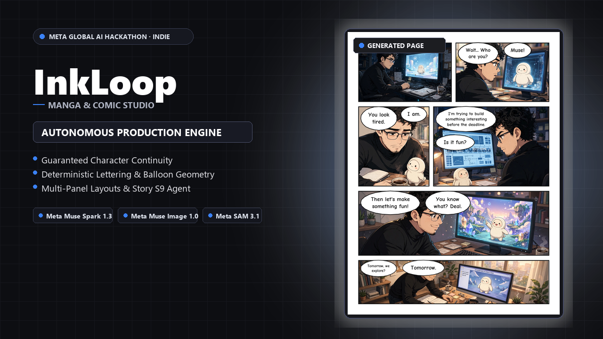
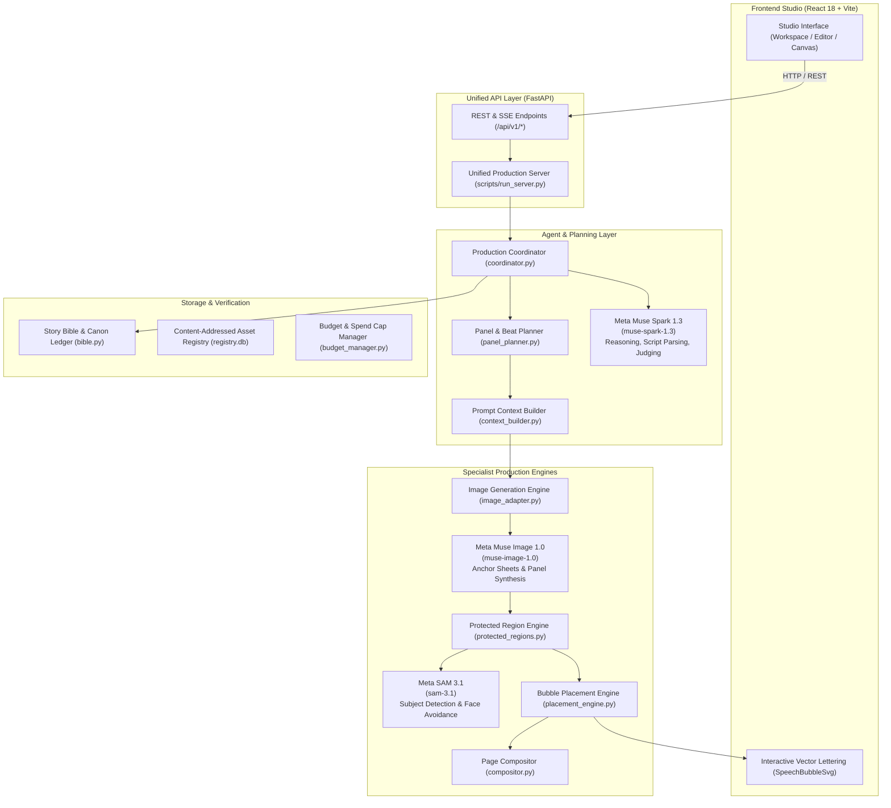

<p align="center">
  
</p>

# InkLoop

> **Autonomous comic, manga, and visual storytelling production engine powered by Meta AI models with guaranteed character continuity and deterministic canvas lettering.**

---

## 1. Demo

[](https://www.youtube.com/watch?v=7rvTbhmrQfs)

<p align="center">
  <a href="https://www.youtube.com/watch?v=7rvTbhmrQfs">
    <strong>▶ Watch Full 1080p Studio Walkthrough on YouTube (1:20)</strong>
  </a>
  &nbsp;•&nbsp;
  <a href="docs/media/demo.mp4">
    <strong>Direct MP4 Video (8.5 MB)</strong>
  </a>
</p>

*Full 1080p studio demonstration walkthrough illustrating script parsing, panel layout planning, character anchor locking, and collision-free speech bubble placement.*

---

## 2. Gallery

A curated selection of sequential comic pages generated and lettered with InkLoop:

| Two-Character Exchange | Expressive Character Acting | Dynamic Physical Movement |
| :---: | :---: | :---: |
| <br>*Two-character conversational staging with clear speaker tail geometry and reading order.* | <br>*Expressive close-ups and medium shots maintaining facial morphology and clothing invariants.* | <br>*Physical movement paneling with somatic posture congruence across panels.* |

| Dialogue Tension | Grid Composition | Climax & Resolution |
| :---: | :---: | :---: |
| <br>*Dialogue interaction conveying narrative tension through restrained character acting.* | <br>*Multi-panel progression following strict left-to-right reading order and border gutters.* | <br>*Final narrative pacing resolution with obstacle-free speech bubbles and tail clearance.* |

*Detailed breakdowns and generation parameters available in the [Page Gallery](docs/GALLERY.md).*

---

## 3. Problem & Solution

AI image generators suffer from severe identity and layout amnesia across sequential panels. When generating a multi-panel visual story, facial structures morph, hairstyles shift, costumes randomly mutate, and text bubbles carelessly obscure characters' faces and focal action. Hand-lettering comics remains tedious, and manual digital tools do not coordinate with narrative scripts.

InkLoop resolves sequential comic production by pairing Meta AI models with deterministic layout geometry. It establishes canonical multi-angle character model sheets, translates script dialogue into structured panel beats, and leverages computer vision segmentation to route vector speech bubbles into open gutters with directional tails. The creator retains full control through an interactive web canvas editor while the system guarantees visual continuity.

---

## 4. Meta AI Models Used

InkLoop integrates three Meta AI models verified across the codebase:

| Model Name | Exact Role in InkLoop | Invocation (REST / SDK) |
| :--- | :--- | :--- |
| **`muse-image-1.0`** | Generates multi-angle character turnaround anchors and high-fidelity comic panel artwork conditioned on character model sheets. | `POST /v1/responses` targeting `muse-image-1.0` with structured negative quality guards (`backend/app/image_adapter.py:53`). |
| **`muse-spark-1.3`** | Performs story script parsing, narrative beat extraction, shot density allocation, and visual judge verification against story bible invariants. | `POST /v1/responses` targeting `muse-spark-1.3` with low reasoning effort and JSON schema contracts (`backend/app/agent/model_client.py:216`). |
| **`sam-3.1`** | Performs promptable subject segmentation (`input_text: "person"`) to detect faces, heads, and eyes, generating obstacle masks for bubble placement. | `POST /v1/responses` targeting `sam-3.1` with concept segmentation prompts (`backend/app/canvas/protected_regions.py:140`). |

---

## 5. Architecture & Data Flow

InkLoop decouples narrative reasoning, artwork synthesis, and vector typography into modular pipelines connected through content-addressed storage:



*For comprehensive architecture details, see [docs/ARCHITECTURE.md](docs/ARCHITECTURE.md).*

---

## 6. Quick Start

Follow these steps to run InkLoop locally:

```bash
# 1. Clone repository
git clone https://github.com/mohgomaa-art/InkLoop.git
cd InkLoop

# 2. Install Python dependencies
python -m venv .venv
# On Windows: .venv\Scripts\Activate.ps1 | On macOS/Linux: source .venv/bin/activate
pip install -r requirements.txt

# 3. Build frontend bundle
cd frontend && npm install && npm run build && cd ..

# 4. Configure environment (optional for offline testing)
cp .env.example .env
# Set MODEL_API_KEY from https://dev.meta.ai in .env for live generation

# 5. Start unified server
python scripts/run_server.py
```

Open **[http://127.0.0.1:8000/](http://127.0.0.1:8000/)** in your browser.

*(Note: InkLoop starts without an API key in offline simulation mode for local layout testing).*

---

## 7. Project Structure

```
InkLoop/
├── backend/
│   ├── app/
│   │   ├── agent/           # Autonomous coordinator, model client, tools
│   │   ├── api/             # FastAPI REST endpoints and preview mounts
│   │   ├── canvas/          # Placement engine, speech bubbles, compositor
│   │   ├── catalogue/       # 60-group image knowledge taxonomy & governance
│   │   ├── contracts/       # Geometry, identity, and artifact interfaces
│   │   ├── execution/       # Budget reservation manager and state ledger
│   │   ├── planning/        # Panel layout, camera angles, and beat planner
│   │   ├── project/         # Story bible, character canon, and snapshots
│   │   ├── storage/         # Content-addressed registry and SQLite database
│   │   └── verification/    # L1 subject and L2 judge visual QA
│   └── tests/               # 827 offline integration and regression tests
├── frontend/
│   ├── src/                 # React 18, TypeScript, and Tailwind studio UI
│   ├── public/              # Previews, fonts, and static assets
│   └── dist/                # Production distribution bundle
├── docs/
│   ├── ARCHITECTURE.md      # Architecture diagram and component data flows
│   ├── CONFIGURATION.md     # Complete environment variable specification
│   ├── GALLERY.md           # 16 web-optimized generated comic pages
│   ├── SETUP.md             # Detailed cross-platform setup instructions
│   └── TROUBLESHOOTING.md   # Common errors and verified resolutions
├── scripts/
│   ├── run_server.py        # Production server entrypoint
│   └── api_smoke_test.py    # Authenticated Meta API connectivity verifier
├── run.bat / run.sh / run.ps1# Platform launcher scripts
├── requirements.txt         # Verified Python dependencies
└── SECURITY.md              # Security policy and credential handling guidelines
```

---

## 8. Testing

InkLoop includes an automated integration and regression test suite:

```bash
# Run the full test suite
pytest backend/tests
```

- **Total Test Count**: 827 tests.
- **Pass Rate**: 825 passed, 2 skipped (by design pending exact sequence replay data), 0 failed.
- **Test Coverage**: Character anchor invariance, obstacle-free bubble routing, reading-direction geometry (LTR/RTL), spend budget caps, content hashing, and canvas editor / PDF export parity.

---

## 9. License

This repository does not currently contain a restrictive license file. An open-source license (such as Apache 2.0 or MIT) will be designated upon public hackathon submission.

---

## 10. Author & Hackathon Submission

- **Event**: Meta Global AI Developer Hackathon
- **Track**: Indie Track
- **Author**: [Mohamed Gomaa (`mohgomaa-art`)](https://github.com/mohgomaa-art)
- **Contact**: `mnile23@gmail.com`
- **Third-Party Credits**: PyMuPDF (PDF rendering), Pillow (image handling), FastAPI (backend framework), React / Vite (studio canvas interface).
