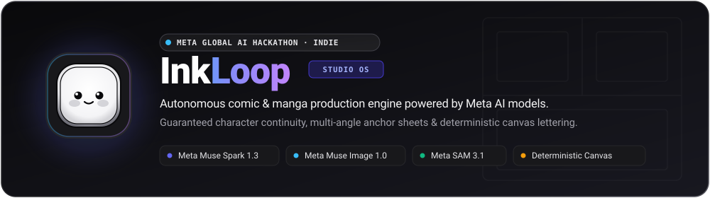
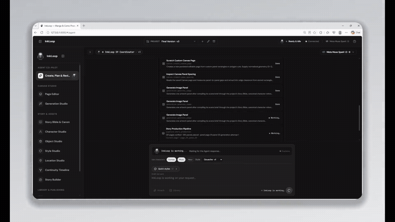
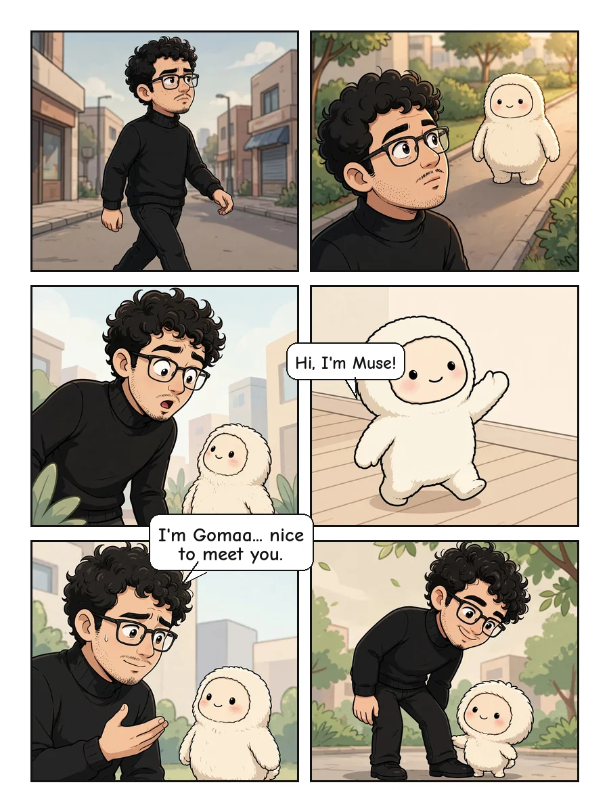
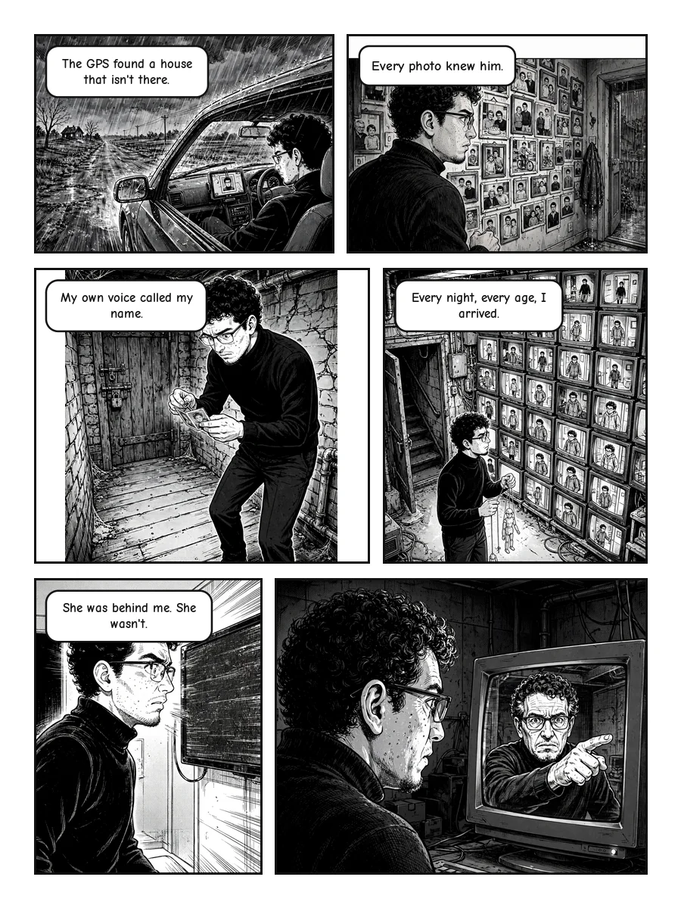
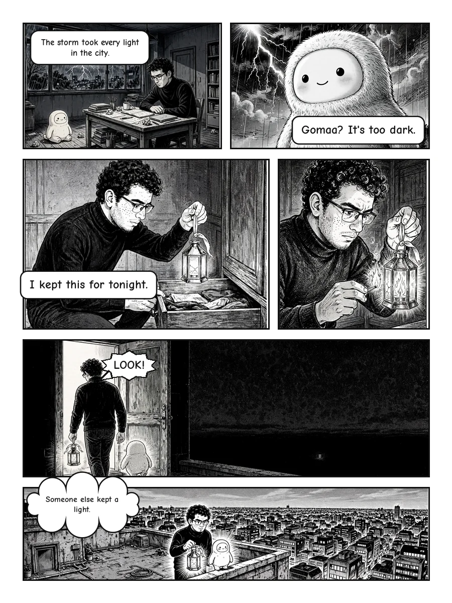
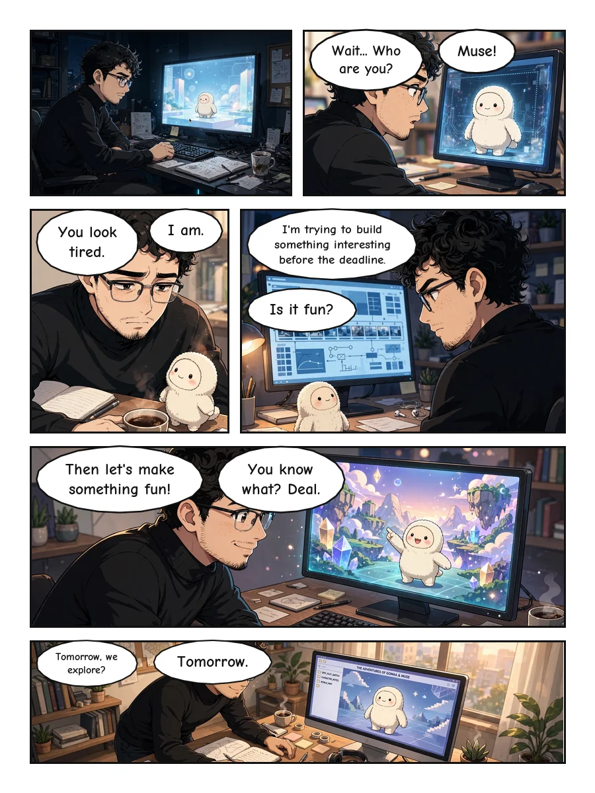
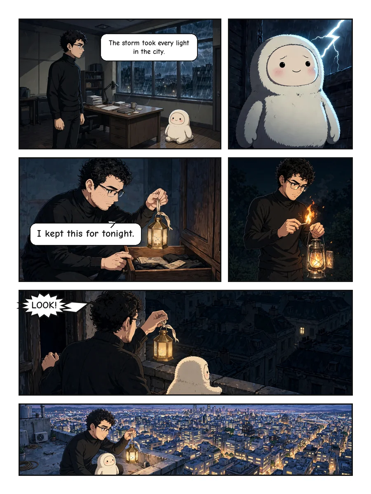
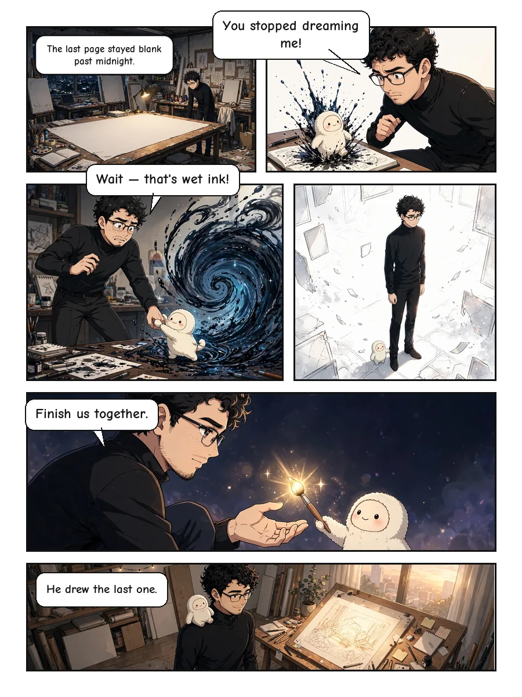
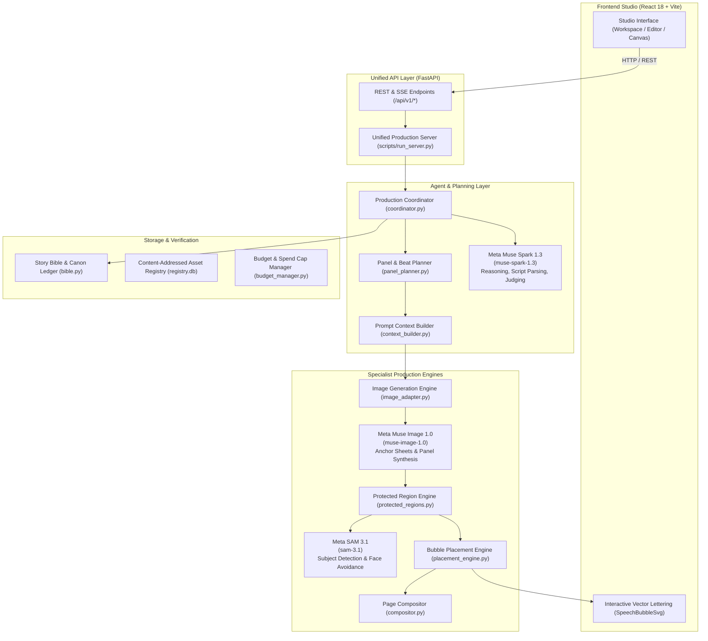

<p align="center">
  
</p>

# InkLoop

> **Autonomous comic and manga production engine that locks character identity and style with reference sheets, places speech bubbles deterministically, and checks panels with a visual judge.**

---

## 1. Demo

[](https://www.youtube.com/watch?v=7rvTbhmrQfs)

<p align="center">
  <a href="https://www.youtube.com/watch?v=7rvTbhmrQfs">
    <strong>▶ Watch Full 1080p Studio Walkthrough on YouTube (1:24)</strong>
  </a>
  &nbsp;•&nbsp;
  <a href="https://github.com/mohgomaa-art/InkLoop/releases/download/v1.0.0/demo.mp4">
    <strong>💾 Download Release MP4 (v1.0.0 · 10 MB)</strong>
  </a>
</p>

*Full 1080p studio demonstration walkthrough illustrating script parsing, panel layout planning, character anchor locking, and collision-free speech bubble placement.*

---

## 2. Gallery

A curated selection of sequential comic pages generated and lettered with InkLoop:

| Two-Character Exchange | Expressive Character Acting | Dynamic Physical Movement |
| :---: | :---: | :---: |
| <br>*Two characters talk across panels with speech bubble tails pointing to the speaker.* | <br>*Close-up and medium shots keep the same face and clothes across different angles.* | <br>*Action panels follow character motion from panel to panel.* |

| Dialogue Tension | Grid Composition | Climax & Resolution |
| :---: | :---: | :---: |
| <br>*Dialogue scene showing character expressions and speech bubbles that avoid covering faces.* | <br>*Multi-panel grid layout supporting both left-to-right and right-to-left reading flow.* | <br>*Closing sequence showing final story beats and clean speech balloon placement.* |

*Detailed breakdowns and generation parameters available in the [Page Gallery](docs/GALLERY.md).*

---

## 3. Problem & Solution

AI image generators often lose track of character appearance across sequential panels. Faces morph, clothes change randomly, and generated speech bubbles cover faces or important action. Hand-lettering comics is slow, and drawing software does not parse scripts into panel layouts.

InkLoop solves sequential comic creation by pairing Meta AI models with deterministic layout geometry. It locks character identity and style using canonical reference sheets, turns scripts into structured panel beats, and segments panels with computer vision to place speech bubbles in open spaces. A visual judge checks generated panels against the story bible. Creators keep full control through an interactive web canvas editor.

---

## 4. Meta AI Models Used

InkLoop integrates three Meta AI models verified across the codebase:

| Model Name | Exact Role in InkLoop | Invocation (REST / SDK) |
| :--- | :--- | :--- |
| **`muse-image-1.0`** | Generates multi-angle character reference sheets and in-panel comic artwork conditioned on reference images. | `POST /images/generations` and `POST /images/edits` targeting `muse-image-1.0` (`backend/app/image_adapter.py:53`, `backend/app/image_adapter.py:152-165`). |
| **`muse-spark-1.3`** | Parses scripts into story beats, plans panel compositions, and evaluates panel artwork against story bible rules. | `POST /responses` targeting `muse-spark-1.3` with structured tool selection and schema validation (`backend/app/agent/model_client.py:216`, `backend/app/agent/model_client.py:457-467`). |
| **`sam-3.1`** | Locates characters, heads, and faces to build obstacle masks so speech bubbles avoid covering key visual subjects. | `POST /responses` targeting `sam-3.1` with promptable concept queries (`backend/app/verification/l1_subject.py:77, 101`, adapted in `backend/app/canvas/protected_regions.py:140`). |

---

## 5. Architecture & Data Flow

InkLoop decouples narrative reasoning, artwork synthesis, and vector typography into modular pipelines connected through content-addressed storage:



*For comprehensive architecture details, see [docs/ARCHITECTURE.md](docs/ARCHITECTURE.md).*

---

## 6. Quick Start

Follow these steps to run InkLoop locally:

```bash
# 1. Clone repository
git clone https://github.com/mohgomaa-art/InkLoop.git
cd InkLoop

# 2. Install Python dependencies
python -m venv .venv
# On Windows: .venv\Scripts\Activate.ps1 | On macOS/Linux: source .venv/bin/activate
pip install -r requirements.txt

# 3. Build frontend bundle
cd frontend && npm install && npm run build && cd ..

# 4. Configure environment (optional for offline testing)
cp .env.example .env
# Set MODEL_API_KEY from https://dev.meta.ai in .env for live generation

# 5. Start unified server
python scripts/run_server.py
```

Open **[http://127.0.0.1:8000/](http://127.0.0.1:8000/)** in your browser.

*(Note: InkLoop starts without an API key in offline simulation mode for local layout testing).*

---

## 7. Project Structure

```
InkLoop/
├── backend/
│   ├── app/
│   │   ├── agent/           # Autonomous coordinator, model client, tools
│   │   ├── api/             # FastAPI REST endpoints and preview mounts
│   │   ├── canvas/          # Placement engine, speech bubbles, compositor
│   │   ├── catalogue/       # 60-group image knowledge taxonomy & governance
│   │   ├── contracts/       # Geometry, identity, and artifact interfaces
│   │   ├── execution/       # Budget reservation manager and state ledger
│   │   ├── planning/        # Panel layout, camera angles, and beat planner
│   │   ├── project/         # Story bible, character canon, and snapshots
│   │   ├── storage/         # Content-addressed registry and SQLite database
│   │   └── verification/    # L1 subject and L2 judge visual QA
│   └── tests/               # 827 offline integration and regression tests
├── frontend/
│   ├── src/                 # React 18, TypeScript, and Tailwind studio UI
│   ├── public/              # Previews, fonts, and static assets
│   └── dist/                # Production distribution bundle
├── docs/
│   ├── ARCHITECTURE.md      # Architecture diagram and component data flows
│   ├── CONFIGURATION.md     # Complete environment variable specification
│   ├── GALLERY.md           # 6 web-optimized generated comic pages
│   ├── SETUP.md             # Detailed cross-platform setup instructions
│   └── TROUBLESHOOTING.md   # Common errors and verified resolutions
├── scripts/
│   ├── run_server.py        # Production server entrypoint
│   └── api_smoke_test.py    # Authenticated Meta API connectivity verifier
├── run.bat / run.sh / run.ps1# Platform launcher scripts
├── requirements.txt         # Verified Python dependencies
└── SECURITY.md              # Security policy and credential handling guidelines
```

---

## 8. Testing

InkLoop includes an automated integration and regression test suite:

```bash
# Run the full test suite
pytest backend/tests
```

- **Total Test Count**: 827 tests collected.
- **Pass Rate**: 826 passed, 1 skipped (by design pending exact sequence replay data), 0 failed in 62.40s.
- **Test Coverage**: Character reference locking, obstacle-free bubble routing, reading-direction geometry (LTR and RTL), budget spend caps, content hashing, and canvas editor to PDF export parity.

---

## 9. License

This project is licensed under the **GNU Affero General Public License v3.0 or later** (AGPL-3.0-or-later) to preserve copyleft compatibility with its core PDF and vector rendering engine. See [LICENSE](LICENSE) for the full license text and [THIRD_PARTY_NOTICES.md](THIRD_PARTY_NOTICES.md) for third-party dependency and font licenses.

---

## 10. Author & Hackathon Submission

- **Event**: Meta Global AI Developer Hackathon
- **Track**: Indie Track
- **Theme**: Build for Your World
- **Author**: [Mohamed Gomaa (`mohgomaa-art`)](https://github.com/mohgomaa-art)
- **Contact**: `mnile23@gmail.com`
- **Third-Party Credits**: PyMuPDF (PDF rendering), Pillow (image handling), FastAPI (backend framework), React / Vite (studio canvas interface).
