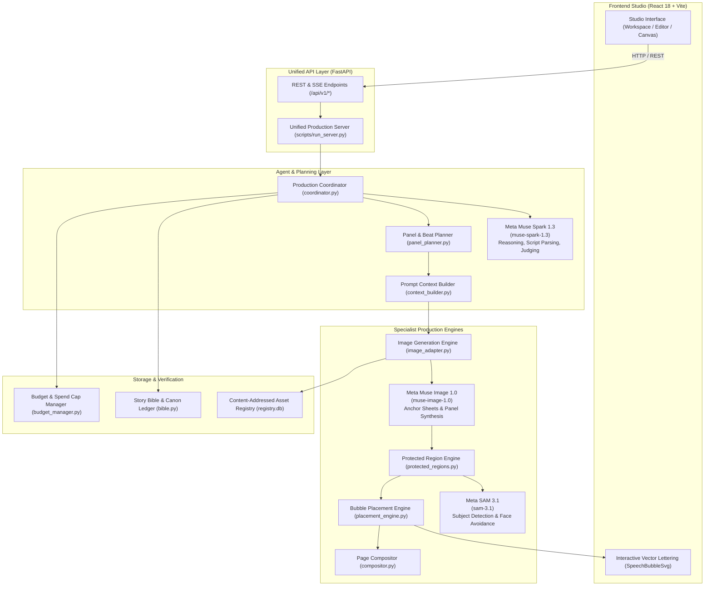

# InkLoop System Architecture

InkLoop is a production system for comic and manga creation that combines Meta AI models with deterministic layout geometry, character consistency anchors, and speech bubble placement.

---

## 1. System Architecture Diagram

---

## 2. Meta AI Model Calls & References

InkLoop integrates three Meta AI models at specific points in the pipeline:

### 1. `muse-spark-1.3` (Script Parsing, Reasoning & Evaluation)
- **Role:** Understands story beats, extracts character actions and dialogue, maps narrative sequence to panel densities, and judges visual compliance against canonical rules.
- **Code References:**
  - `backend/app/agent/model_client.py` (Line 216)
  - `backend/app/api/routers/verification.py` (Line 45)
  - `backend/app/config.py` (Line 32)

### 2. `muse-image-1.0` (Character Reference Sheets & Panel Synthesis)
- **Role:** Synthesizes high-fidelity character anchor turnaround sheets and renders in-panel comic illustrations with conditioning on visual invariants.
- **Code References:**
  - `backend/app/context_builder.py` (Line 678)
  - `backend/app/image_adapter.py` (Line 53)
  - `backend/app/parsers.py` (Line 82)
  - `backend/app/api/routers/generation.py` (Line 59)

### 3. `sam-3.1` (Subject Segmentation & Protected Regions)
- **Role:** Performs promptable segmentation on generated panel art to identify character heads, faces, and focal objects, creating bounding obstacles so speech bubbles never cover character features.
- **Code References:**
  - `backend/app/canvas/protected_regions.py` (Lines 133, 140)
  - `backend/app/verification/l1_subject.py` (Line 77)
  - `backend/app/parsers.py` (Line 15)

---

## 3. Data Flow

1. **Story Intake:** The user inputs a script or story prompt.
2. **Beat & Panel Planning:** `muse-spark-1.3` plans panel beats, camera angles, shot scales, and dialogue.
3. **Context Compilation:** `context_builder.py` injects canonical character anchors and style tokens.
4. **Artwork Generation:** `muse-image-1.0` generates individual panel artwork.
5. **Obstacle Detection:** `sam-3.1` segments characters and identifies faces/eyes.
6. **Lettering & Placement:** `placement_engine.py` positions speech bubbles in clear gutters, routing tails toward speakers.
7. **Document Assembly:** `compositor.py` combines panel art, vector speech bubbles, and gutters into the final page.
